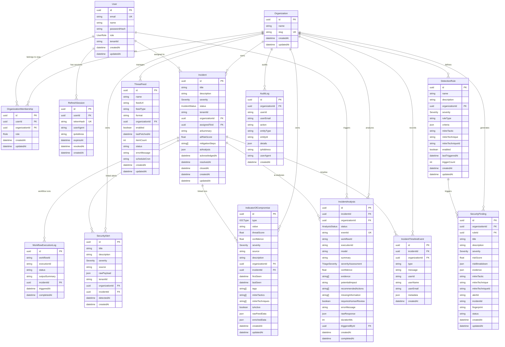

# SentinelFlow — Database ER Diagram

> Generated from `apps/api/prisma/schema.prisma`  
> PostgreSQL 16 with Prisma ORM  
> All tables enforce tenant isolation via `organizationId`

---

---

## Tenant Isolation Key Indexes

| Table | Index | Purpose |
|---|---|---|
| `Incident` | `organizationId` | Filter incidents by tenant |
| `Incident` | `tenantId` | Legacy compatibility filter |
| `SecurityAlert` | `organizationId` | Filter alerts by tenant |
| `SecurityAlert` | `detectedAt` | Time-range queries |
| `IndicatorOfCompromise` | `organizationId` | Filter IOCs by tenant |
| `IndicatorOfCompromise` | `value` | IOC lookup during detection eval |
| `SecurityFinding` | `fingerprint` | Alert storm deduplication |
| `SecurityFinding` | `organizationId` | Filter findings by tenant |
| `DetectionRule` | `organizationId` | Load rules per tenant |
| `AuditLog` | `organizationId, createdAt` | Tenant audit pagination |
| `RefreshSession` | `tokenHash` | O(1) token lookup |
| `RefreshSession` | `userId` | Session revocation per user |

---

## Enumerations

| Enum | Values |
|---|---|
| `Severity` | `LOW`, `MEDIUM`, `HIGH`, `CRITICAL` |
| `IncidentStatus` | `NEW`, `TRIAGED`, `INVESTIGATING`, `CONTAINED`, `RESOLVED`, `CLOSED` |
| `IOCType` | `IP`, `DOMAIN`, `HASH_SHA256`, `HASH_MD5`, `URL`, `EMAIL` |
| `Role` (org membership) | `VIEWER`, `ANALYST`, `ADMIN` |
| `UserRole` (global) | `ANALYST`, `SOC_LEAD`, `ADMIN` |
| `AnalysisStatus` | `PENDING`, `COMPLETED`, `FAILED` |
| `TriageSeverity` | `INFORMATIONAL`, `LOW`, `MEDIUM`, `HIGH`, `CRITICAL` |
